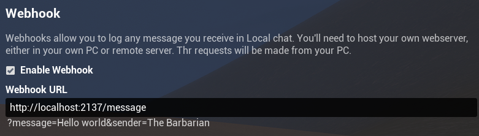
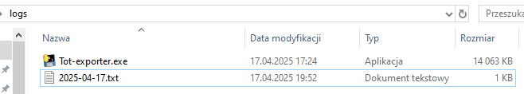

# Tot-exporter

A lightweight Windows system tray app that receives local chat webhooks from the Conan Exiles **Tot!** mod and exports them to daily UTC text logs.

## Features
- **System tray background app**: Runs quietly in the Windows system tray without a cluttered console window.
- **Start with Windows**: Built-in per-user Windows startup toggle (available in both the tray menu and viewer window) using the standard `HKCU\...\Run` registry key — no admin privileges required.
- **On-demand live chat viewer**: Click the tray icon (or select **Open Viewer**) to view decoded `[HH:MM:SS] Sender: Message` chat lines in real time, copy the webhook URL, or open your logs folder.
- **Automatic server IP detection**: Watches the clipboard for any `IP:port` (supporting all valid ports `1–65535`) and tags log filenames automatically (`YYYY-MM-DD-<IP>.txt`). You can also set or clear the server IP manually from the viewer.

## Usage
### Standard (RECOMMENDED)
1. Download the most recent release from [Releases](https://github.com/Simman102/Tot-exporter/releases).
2. Run `Tot-exporter.exe` (decline any firewall popups; this only listens locally and does not need Internet access).
   - It starts in the Windows system tray. Click the tray icon to open the live chat viewer window (or pass `--open` to show the window on launch).
3. Enable webhooks in Tot and set the address to `http://localhost:2137/message`.

4. Local chat messages are exported to files named `<year-month-day>.txt` (or `<year-month-day>-<server-ip>.txt`) in the same directory as `Tot-exporter.exe`, using UTC timestamps.

### Python
1. Install [Python](https://www.python.org/) (3.10+).
2. Navigate to `src/`.
3. Install dependencies: `pip install -r requirements.txt`
4. Run it via `py Tot-exporter.py` (or `py Tot-exporter.py --open` to open the viewer immediately).
